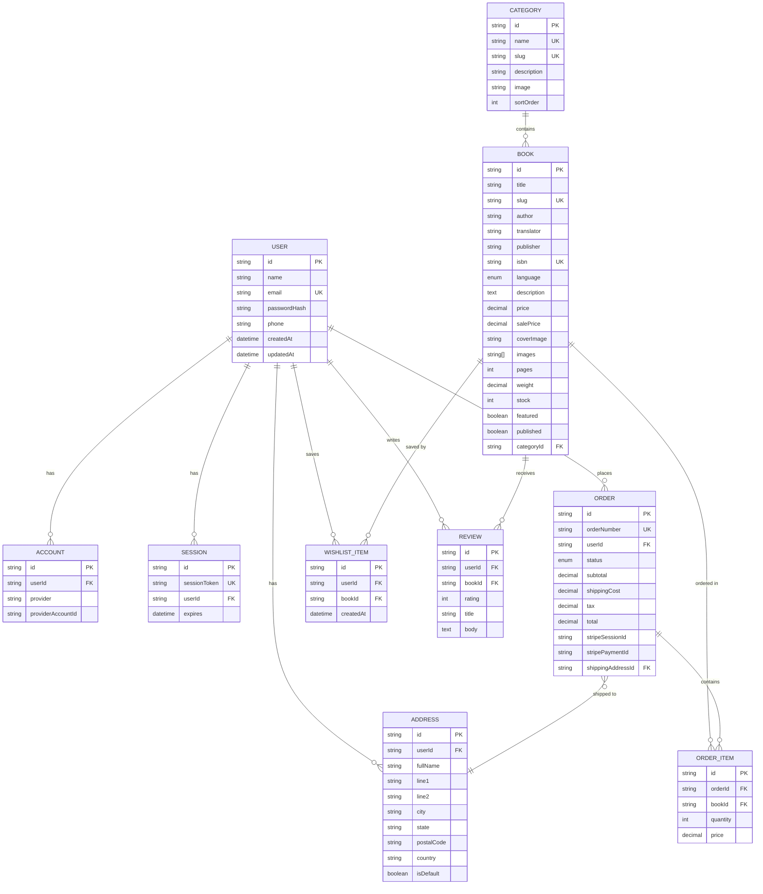

# 📖 Islamic Bookstore — Project Plan

> **Bayt al-Kutub** (بيت الكتب) — "House of Books"
> A modern, elegant e-commerce platform for Islamic literature.

---

## 1. Tech Stack Overview

| Layer            | Technology                          |
| ---------------- | ----------------------------------- |
| Framework        | Next.js 15 (App Router)             |
| Language         | TypeScript 5.7                      |
| Styling          | Tailwind CSS 3.4 + Shadcn UI       |
| Database         | PostgreSQL                          |
| ORM              | Prisma 6                            |
| Authentication   | NextAuth.js v4 (Prisma Adapter)     |
| Payments         | Stripe Checkout                     |
| State Management | Zustand 5 (persisted cart)          |
| Icons            | Lucide React                        |
| Fonts            | Inter (sans) + Amiri (serif/Arabic) |

---

## 2. Design System

### Color Palette

```
Primary (Emerald)     #059669  — buttons, links, accents
Gold Highlight        #d4a853  — badges, sale tags, Islamic motifs
Cream Background      #fefdfb  — page background
Charcoal Text         #2d2d2d  — body text
White                 #ffffff  — cards, inputs
```

### Typography

| Use                         | Font    | Weight      |
| --------------------------- | ------- | ----------- |
| UI text, navigation, body   | Inter   | 400 / 500 / 600 / 700 |
| Book titles, Arabic terms   | Amiri   | 400 / 700   |

### Spacing & Layout

- Max content width: **1400px** centered
- Grid: 12-column responsive (1→2→3→4 cols)
- Border radius: **0.5rem** (cards), **0.25rem** (buttons/inputs)
- Consistent `p-4` / `p-6` / `p-8` spacing scale

---

## 3. Database Schema

### Entity Relationship Diagram



### Enums

| Enum          | Values                                                    |
| ------------- | --------------------------------------------------------- |
| `Language`    | `ENGLISH`, `ARABIC`, `URDU`                               |
| `OrderStatus` | `PENDING`, `PROCESSING`, `SHIPPED`, `DELIVERED`, `CANCELLED`, `REFUNDED` |

---

## 4. Folder Structure

```
islamic-bookstore/
├── prisma/
│   ├── schema.prisma              # Database schema
│   └── seed/
│       └── index.ts               # Seed script (10 Islamic books)
│
├── public/
│   ├── fonts/                     # Inter + Amiri font files
│   └── images/
│       ├── books/                 # Book cover placeholders
│       └── icons/                 # Favicon, logo, category icons
│
├── src/
│   ├── app/
│   │   ├── layout.tsx             # Root layout (fonts, providers, navbar, footer)
│   │   ├── page.tsx               # Homepage (hero, categories, featured)
│   │   │
│   │   ├── (shop)/                # Route group — shopping pages
│   │   │   ├── books/
│   │   │   │   ├── page.tsx       # Catalog with filters
│   │   │   │   └── [id]/
│   │   │   │       └── page.tsx   # Product Detail Page
│   │   │   ├── cart/
│   │   │   │   └── page.tsx       # Full cart view
│   │   │   └── checkout/
│   │   │       ├── page.tsx       # Checkout flow
│   │   │       └── success/
│   │   │           └── page.tsx   # Post-payment confirmation
│   │   │
│   │   ├── (auth)/                # Route group — authentication
│   │   │   ├── login/
│   │   │   │   └── page.tsx       # Login page
│   │   │   └── register/
│   │   │       └── page.tsx       # Registration page
│   │   │
│   │   ├── (account)/             # Route group — user account
│   │   │   ├── profile/
│   │   │   │   └── page.tsx       # Profile & settings
│   │   │   ├── orders/
│   │   │   │   └── page.tsx       # Order history
│   │   │   └── wishlist/
│   │   │       └── page.tsx       # Saved books
│   │   │
│   │   └── api/
│   │       ├── auth/
│   │       │   └── [...nextauth]/
│   │       │       └── route.ts   # NextAuth API route
│   │       ├── books/
│   │       │   ├── route.ts       # GET /api/books (list + filters)
│   │       │   └── [id]/
│   │       │       └── route.ts   # GET /api/books/:id
│   │       ├── categories/
│   │       │   └── route.ts       # GET /api/categories
│   │       ├── cart/
│   │       │   └── route.ts       # Cart validation endpoint
│   │       ├── checkout/
│   │       │   └── route.ts       # POST → Stripe session
│   │       ├── orders/
│   │       │   └── route.ts       # GET user orders
│   │       └── wishlist/
│   │           └── route.ts       # GET/POST/DELETE wishlist
│   │
│   ├── components/
│   │   ├── ui/                    # Shadcn UI primitives
│   │   │   ├── button.tsx
│   │   │   ├── card.tsx
│   │   │   ├── input.tsx
│   │   │   ├── badge.tsx
│   │   │   ├── dialog.tsx
│   │   │   ├── select.tsx
│   │   │   ├── separator.tsx
│   │   │   ├── skeleton.tsx
│   │   │   ├── toast.tsx
│   │   │   └── tooltip.tsx
│   │   │
│   │   ├── layout/                # Structural components
│   │   │   ├── navbar.tsx
│   │   │   ├── footer.tsx
│   │   │   ├── mobile-nav.tsx
│   │   │   ├── search-bar.tsx
│   │   │   └── providers.tsx      # Session + theme providers
│   │   │
│   │   ├── books/                 # Book-related components
│   │   │   ├── book-card.tsx
│   │   │   ├── book-grid.tsx
│   │   │   ├── book-filters.tsx
│   │   │   ├── book-detail.tsx
│   │   │   ├── related-books.tsx
│   │   │   └── category-card.tsx
│   │   │
│   │   ├── cart/                  # Cart components
│   │   │   ├── cart-sidebar.tsx
│   │   │   ├── cart-item.tsx
│   │   │   └── cart-summary.tsx
│   │   │
│   │   ├── checkout/              # Checkout components
│   │   │   └── checkout-form.tsx
│   │   │
│   │   └── auth/                  # Auth components
│   │       ├── login-form.tsx
│   │       └── register-form.tsx
│   │
│   ├── lib/
│   │   ├── prisma.ts              # Prisma client singleton
│   │   ├── stripe.ts              # Stripe client
│   │   ├── auth.ts                # NextAuth config
│   │   └── utils.ts               # cn(), formatPrice(), slugify()
│   │
│   ├── store/
│   │   └── cart.ts                # Zustand cart store (persisted)
│   │
│   ├── hooks/
│   │   ├── use-debounce.ts        # Debounce hook for search
│   │   └── use-media-query.ts     # Responsive breakpoint hook
│   │
│   ├── styles/
│   │   └── globals.css            # Tailwind base + CSS variables
│   │
│   └── types/
│       └── index.ts               # Shared TypeScript interfaces
│
├── .env.example                   # Environment variable template
├── .gitignore
├── next.config.js
├── package.json
├── postcss.config.js
├── tailwind.config.ts
├── tsconfig.json
└── PLAN.md                        # ← You are here
```

---

## 5. Phase Breakdown

### Phase 1 — Planning & Setup ✅ (Current)
- [x] Initialize Next.js project with TypeScript
- [x] Configure Tailwind CSS with custom brand palette
- [x] Set up Prisma with full database schema
- [x] Create Zustand cart store
- [x] Define TypeScript types
- [x] Create project plan (this file)

### Phase 2 — Database & API
- [ ] Configure local PostgreSQL connection
- [ ] Run `prisma db push` to create tables
- [ ] Write seed script with 10 Islamic books across 5 categories
- [ ] Build API routes:
  - `GET /api/books` — list with filtering, sorting, pagination
  - `GET /api/books/:id` — single book detail
  - `GET /api/categories` — all categories

### Phase 3 — Frontend Shell
- [ ] Set up Inter + Amiri fonts in root layout
- [ ] Build responsive Navbar (logo, search, cart icon with badge, user menu)
- [ ] Build Footer (links, about, newsletter signup)
- [ ] Build Homepage:
  - Hero banner with CTA
  - Category grid (Quran, Hadith, Seerah, Fiqh, Kids)
  - Featured books carousel/grid
  - "New Arrivals" section
- [ ] Create reusable BookCard component
- [ ] Mobile-responsive hamburger menu

### Phase 4 — Shopping Experience
- [ ] Product Catalog page with sidebar filters:
  - Category filter
  - Language filter (English, Arabic, Urdu)
  - Price range slider
  - Author filter
  - Sort dropdown
- [ ] Product Detail Page:
  - Book cover image gallery
  - Full book metadata
  - Add to Cart button
  - Related Books section
- [ ] Wire up Zustand cart:
  - Slide-out cart sidebar
  - Add/remove/update quantities
  - Cart persistence across sessions

### Phase 5 — Auth & Checkout
- [ ] NextAuth.js configuration:
  - Credentials provider (email/password)
  - Google OAuth provider
  - Prisma adapter for session/user persistence
- [ ] Login & Registration pages
- [ ] Protected routes middleware
- [ ] Stripe Checkout integration:
  - Create Stripe checkout session from cart
  - Success/cancel redirect pages
  - Webhook handler for order fulfillment
- [ ] User profile page
- [ ] Order history page
- [ ] Wishlist functionality

---

## 6. API Routes Reference

| Method | Endpoint                 | Description                    | Auth Required |
| ------ | ------------------------ | ------------------------------ | ------------- |
| GET    | `/api/books`             | List books (filter/sort/page)  | No            |
| GET    | `/api/books/:id`         | Get book details               | No            |
| GET    | `/api/categories`        | List all categories            | No            |
| POST   | `/api/checkout`          | Create Stripe checkout session | Yes           |
| POST   | `/api/webhooks/stripe`   | Stripe webhook handler         | No (verified) |
| GET    | `/api/orders`            | Get user's order history       | Yes           |
| GET    | `/api/wishlist`          | Get user's wishlist            | Yes           |
| POST   | `/api/wishlist`          | Add to wishlist                | Yes           |
| DELETE | `/api/wishlist/:bookId`  | Remove from wishlist           | Yes           |

---

## 7. Seed Data Preview

The database will be seeded with **5 categories** and **10 books**:

| # | Title                                | Author              | Category | Lang    |
|---|--------------------------------------|----------------------|----------|---------|
| 1 | The Noble Quran (English Translation) | Muhsin Khan & Hilali | Quran    | English |
| 2 | Tafsir Ibn Kathir (Abridged)          | Ibn Kathir           | Quran    | English |
| 3 | Sahih Al-Bukhari                      | Imam Bukhari         | Hadith   | English |
| 4 | Riyad us-Saliheen                     | Imam An-Nawawi       | Hadith   | English |
| 5 | The Sealed Nectar (Ar-Raheeq Al-Makhtum) | Safiur-Rahman Mubarakpuri | Seerah | English |
| 6 | Muhammad: His Life Based on the Earliest Sources | Martin Lings | Seerah | English |
| 7 | Fiqh Us-Sunnah                        | Sayyid Sabiq         | Fiqh     | English |
| 8 | The Reliance of the Traveller         | Ahmad ibn Naqib      | Fiqh     | English |
| 9 | My First Quran Storybook              | Saniyasnain Khan     | Kids     | English |
| 10| Goodnight Stories from the Quran       | Saniyasnain Khan     | Kids     | English |

---

## 8. Key Design Decisions

1. **App Router over Pages Router** — leverages React Server Components for faster data loading and smaller client bundles.
2. **Zustand over React Context** — simpler API, built-in persistence middleware, no provider nesting.
3. **Stripe Checkout (hosted)** — reduces PCI compliance burden; redirects to Stripe's hosted page.
4. **Prisma over raw SQL** — type-safe queries, auto-generated types, easy migrations.
5. **Route Groups** — `(shop)`, `(auth)`, `(account)` keep routes organized without affecting URL paths.
6. **Server Components by default** — only interactive components (`"use client"`) like cart sidebar, search bar, and filters.
